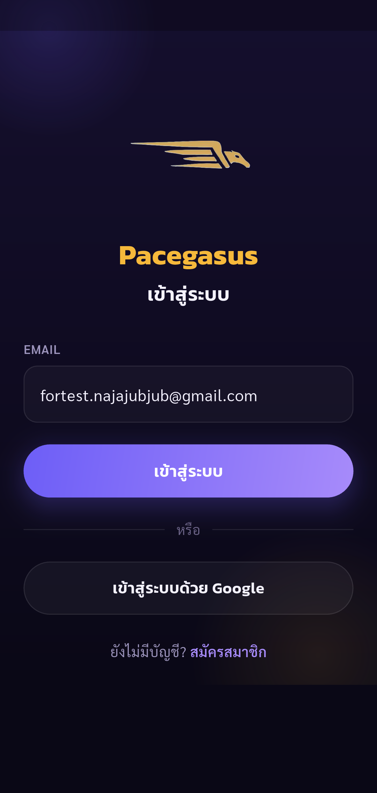
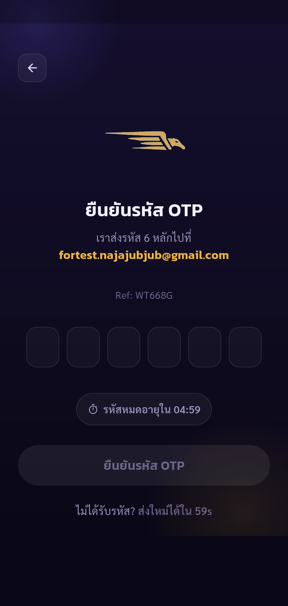
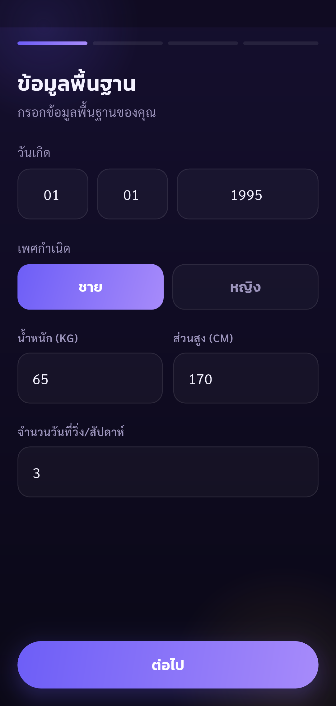
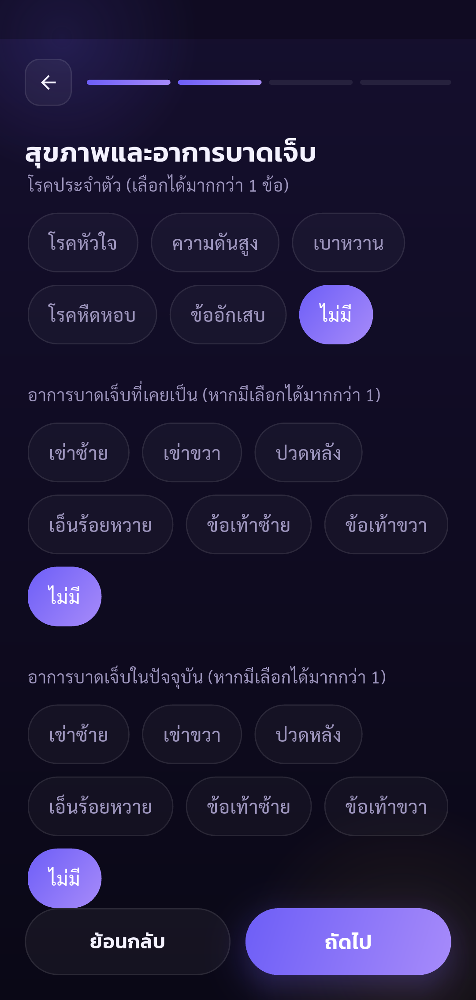
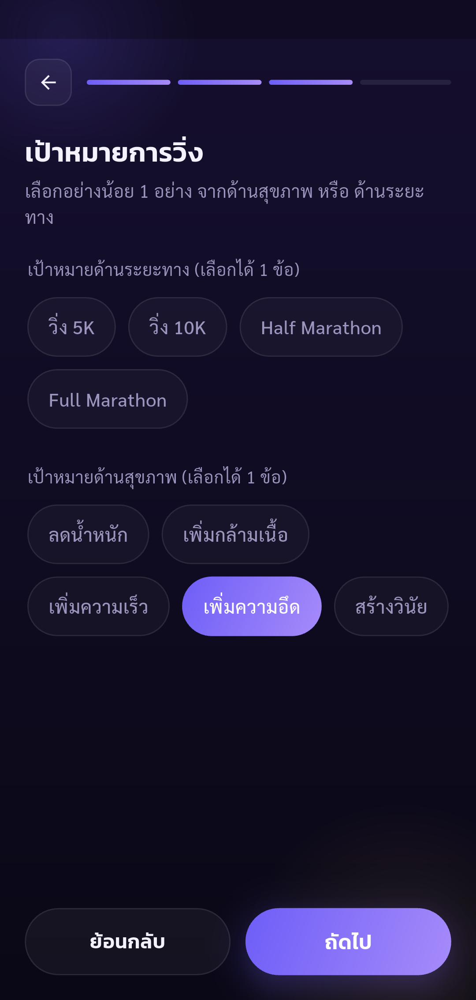
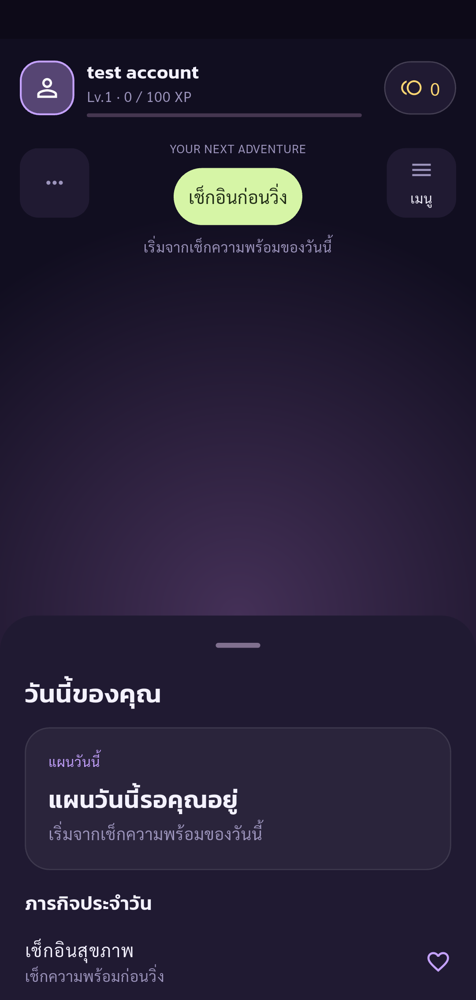
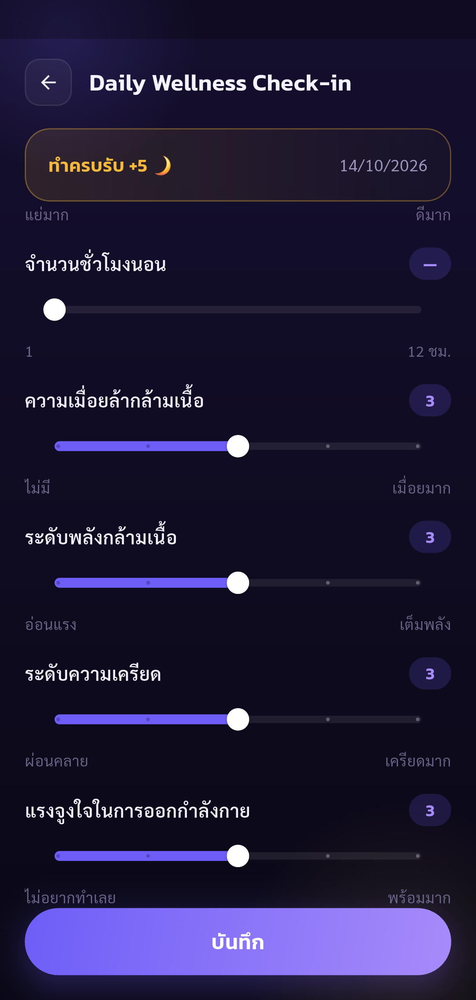
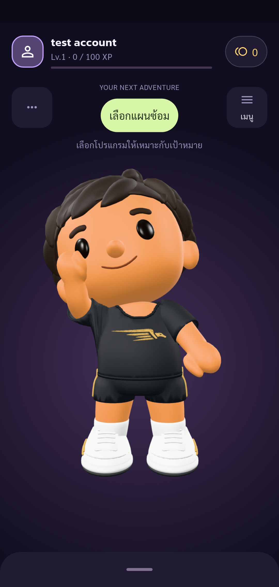
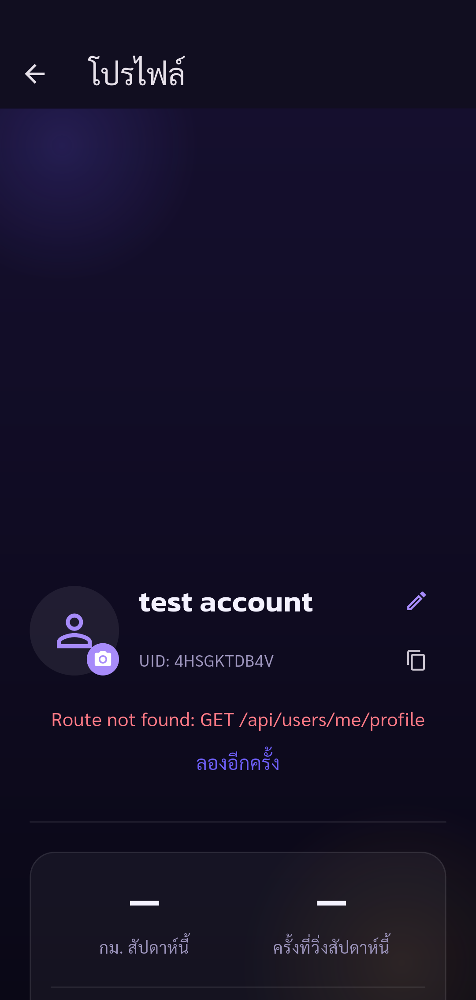

# Automated UAT — Pacegasus

Status: **failed**

Failed at profile: Expected: no matching candidates
  Actual: _TextWidgetFinder:<Found 1 widget with text "ลองอีกครั้ง": [
            Text("ลองอีกครั้ง", dependencies: [DefaultSelectionStyle, DefaultTextStyle, MediaQuery]),
          ]>
   Which: means one was found but none were expected

Tests run through Flutter Integration Test against the configured real API.
Onboarding values are synthetic. Screenshots are evidence of the stated assertions, not complete visual approval.

| Step | Result | Evidence |
| --- | --- | --- |
| Existing account email entered on Login | passed | [01-existing-login](screenshots/01-existing-login.png) |
| Login OTP requested for existing account | passed | [02-login-otp](screenshots/02-login-otp.png) |
| Existing account restored or authenticated with correct email and name | passed | [03-existing-authenticated](screenshots/03-existing-authenticated.png) |
| Synthetic birth date, gender, weight, height and training days validate | passed | [07-basic-valid](screenshots/07-basic-valid.png) |
| Synthetic no-condition and no-injury answers selected | passed | [08-health](screenshots/08-health.png) |
| Only increased-endurance health goal selected; no distance goal | passed | [09-goal](screenshots/09-goal.png) |
| Synthetic beginner running history selected | passed | [10-history](screenshots/10-history.png) |
| Onboarding completes and Home shows test account | passed | [11-home](screenshots/11-home.png) |
| Five required wellness scores enable Save | passed | [12-wellness-valid](screenshots/12-wellness-valid.png) |
| Real API accepts wellness and Home updates | passed | [13-wellness-saved](screenshots/13-wellness-saved.png) |
| Failure at profile | failed | [failed-profile](screenshots/failed-profile.png) |

## Screenshots

### Existing account email entered on Login

### Login OTP requested for existing account

### Existing account restored or authenticated with correct email and name

### Synthetic birth date, gender, weight, height and training days validate

### Synthetic no-condition and no-injury answers selected

### Only increased-endurance health goal selected; no distance goal

### Synthetic beginner running history selected

### Onboarding completes and Home shows test account

### Five required wellness scores enable Save

### Real API accepts wellness and Home updates

### Failure at profile

## Final outcome

Existing-account login/OTP, health-only onboarding (all four pages), Home and
wellness saving passed. History answers were `ไม่เคย` and `น้อยกว่า 5 km`.
The account is now onboarded and can be used for subsequent existing-account runs.

Profile failed because the screen displayed:

> Route not found: GET /api/users/me/profile

The displayed name and UID came from authenticated account state; they do not
prove the profile API loaded successfully. The final assertion correctly rejected
the retry/error state. See `screenshots/failed-profile.png`. A working deployed
profile endpoint is required before this suite can pass completely.

OTP input was consumed and is not stored in the evidence report.
