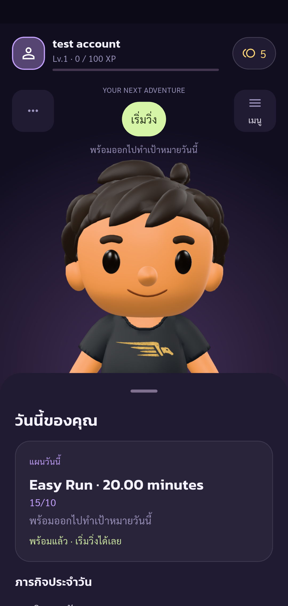
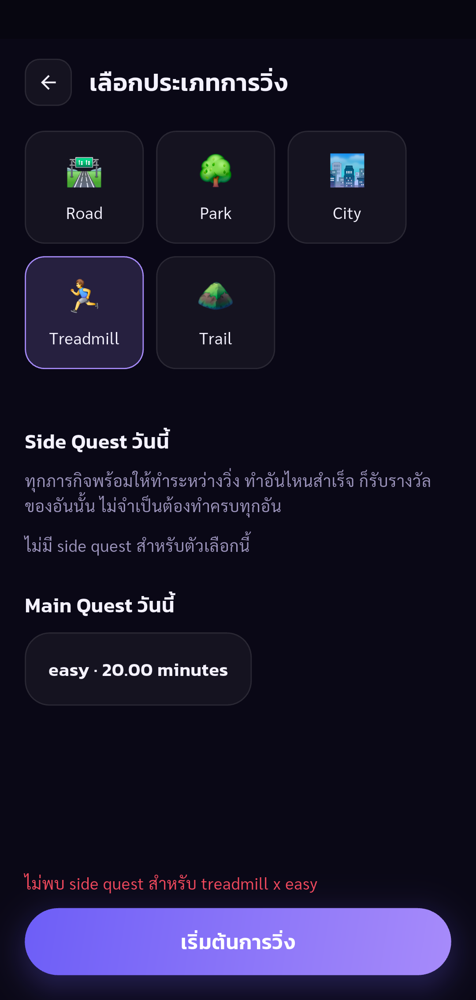
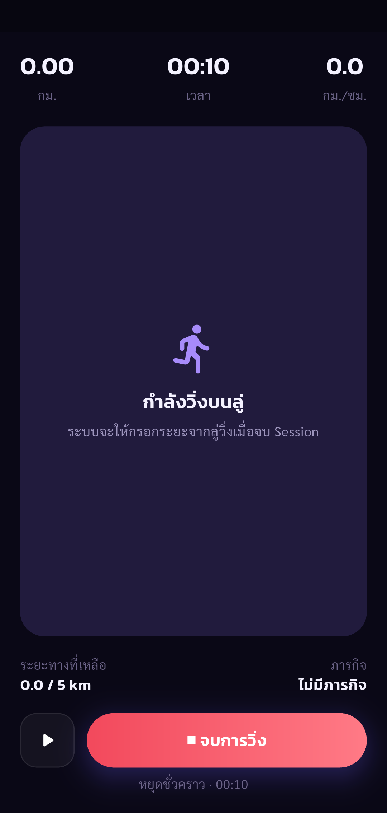
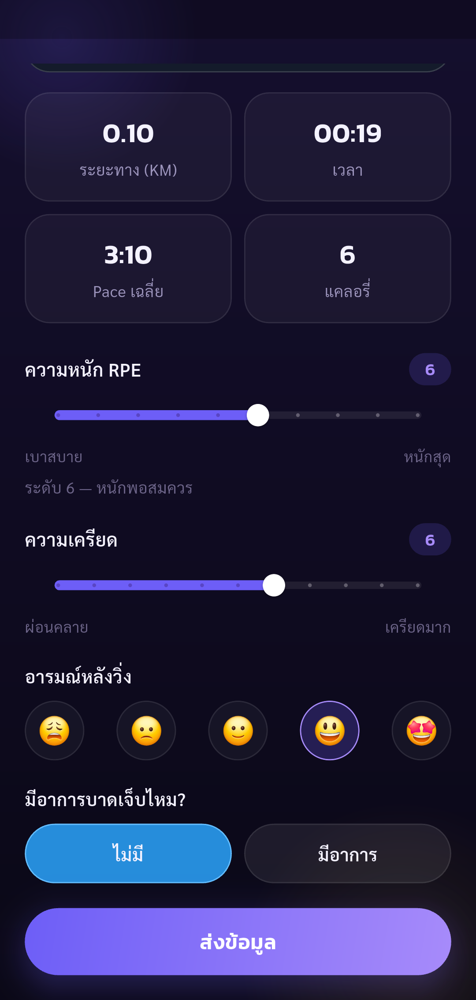
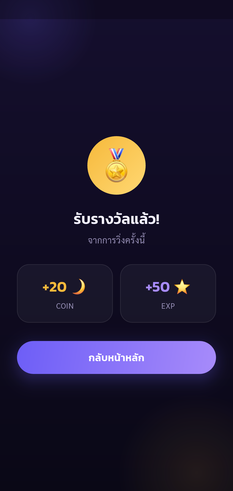
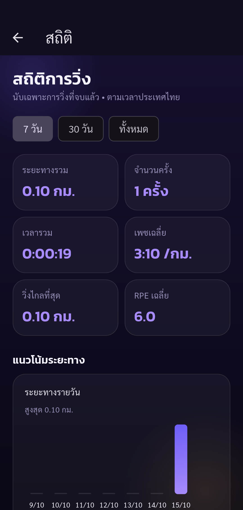

# Automated UAT — Pacegasus

Status: **failed**

Phase run failed at run. See test assertion output; remaining steps were not run.

Tests run through Flutter Integration Test against the configured real API.
Real UI treadmill workflow using synthetic 0.10 km UAT input and real elapsed time. Checks start/pause/resume/finish, feedback, reward consistency, stats/history and ranking. This is not a physical run or a GPS accuracy test. Other UAT cases remain Not Run.

Screenshots support only the stated assertions. A completed phase does not mean all 88 UAT cases passed.

| Step | Result | Evidence |
| --- | --- | --- |
| Expected account authenticated, onboarding complete, real public UID verified | passed | [identity](screenshots/identity.png) |
| Blocked: real API has no side quests for treadmill/easy; run lifecycle continues without side quests | blocked | [treadmill-side-quests-unavailable](screenshots/treadmill-side-quests-unavailable.png) |
| Treadmill selected; quest lookup finished before start; absent quest data reported separately; synthetic input disclosed | passed | [run-environment](screenshots/run-environment.png) |
| Real session is in progress; pause stops elapsed time for three seconds | passed | [run-paused](screenshots/run-paused.png) |
| Summary shows entered 0.10 km; feedback incomplete so Submit disabled | passed | [run-summary](screenshots/run-summary.png) |
| RPE/stress selected, good mood and no pain; Submit enabled | passed | [run-feedback](screenshots/run-feedback.png) |
| Reward screen claims 20 coins but server coin delta is 5 | failed | [run-reward-mismatch](screenshots/run-reward-mismatch.png) |
| Failure at run; see assertion output | failed | [failed-run](screenshots/failed-run.png) |

## Screenshots

### Expected account authenticated, onboarding complete, real public UID verified

### Blocked: real API has no side quests for treadmill/easy; run lifecycle continues without side quests

### Treadmill selected; quest lookup finished before start; absent quest data reported separately; synthetic input disclosed

### Real session is in progress; pause stops elapsed time for three seconds

### Summary shows entered 0.10 km; feedback incomplete so Submit disabled

### RPE/stress selected, good mood and no pain; Submit enabled

### Reward screen claims 20 coins but server coin delta is 5

### Failure at run; see assertion output

