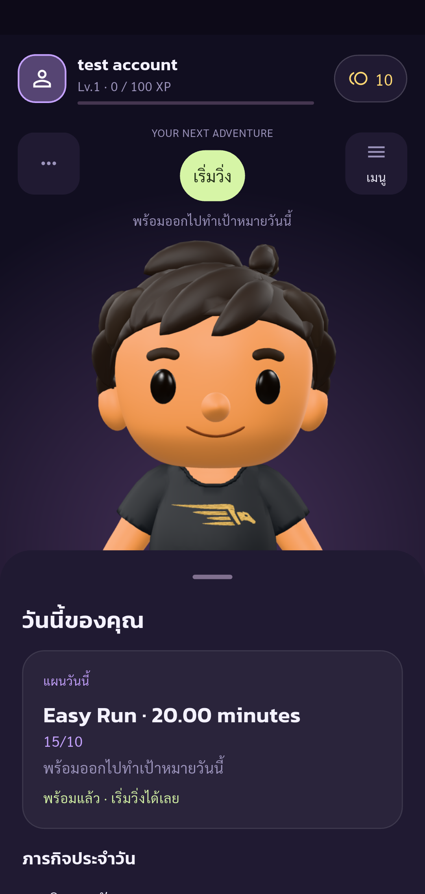
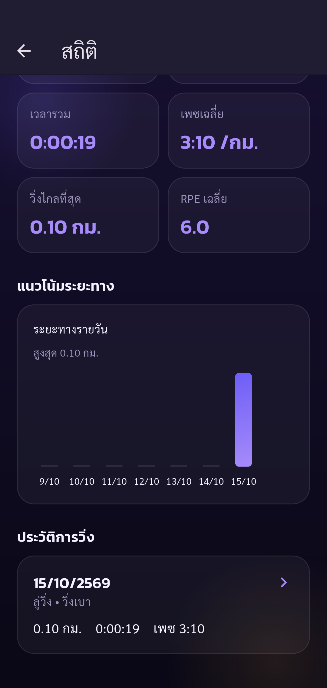
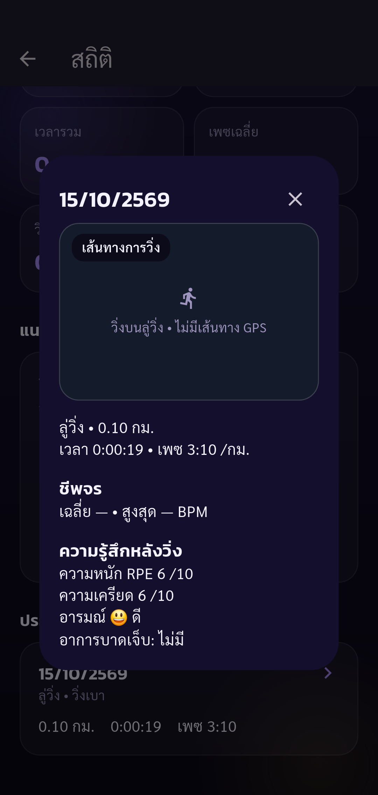
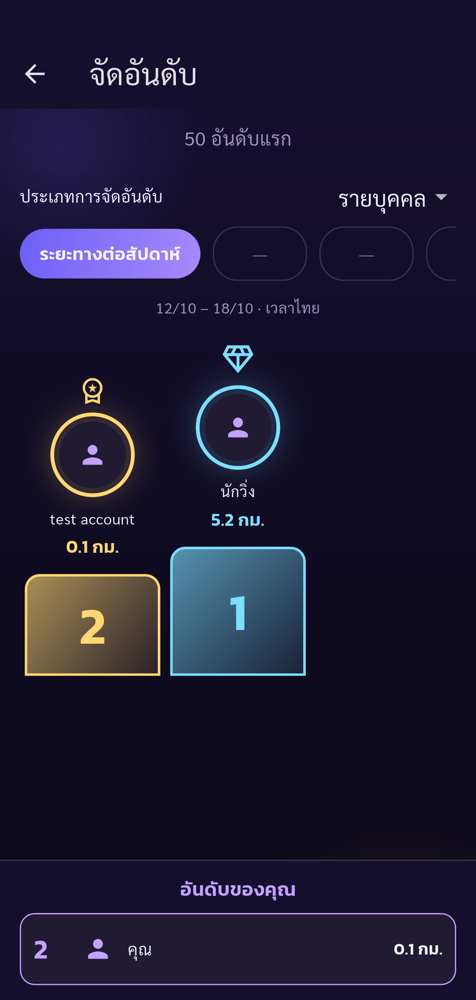

# Automated UAT — Pacegasus

Status: **passed**

Phase run-review completed: only listed assertions passed. Other UAT cases remain Not Run.

Tests run through Flutter Integration Test against the configured real API.
Review only: existing latest 0.10 km synthetic treadmill session. No new run or feedback submitted. Checks Stats totals, history detail and individual ranking. Earlier reward failure remains unresolved.

Screenshots support only the stated assertions. A completed phase does not mean all 88 UAT cases passed.

| Step | Result | Evidence |
| --- | --- | --- |
| Expected account authenticated, onboarding complete, real public UID verified | passed | [identity](screenshots/identity.png) |
| Displayed seven-day distance, count and duration match real completed run history | passed | [run-stat-totals](screenshots/run-stat-totals.png) |
| Existing recorded 0.10 km treadmill session appears in history; no duplicate run created | passed | [run-history](screenshots/run-history.png) |
| Recorded treadmill session detail displays stored RPE and no pain | passed | [run-history-detail](screenshots/run-history-detail.png) |
| Thai weekly individual ranking includes the existing run; own ranking section visible and API Top 50 ordered | passed | [run-ranking](screenshots/run-ranking.png) |

## Screenshots

### Expected account authenticated, onboarding complete, real public UID verified

### Displayed seven-day distance, count and duration match real completed run history

### Existing recorded 0.10 km treadmill session appears in history; no duplicate run created

### Recorded treadmill session detail displays stored RPE and no pain

### Thai weekly individual ranking includes the existing run; own ranking section visible and API Top 50 ordered

