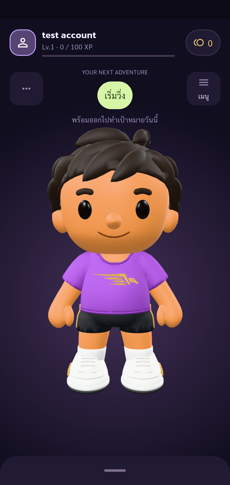

# UAT — ร้านค้าและ Avatar

บัญชีหลัก fortest.najajubjub@gmail.com บนแอปจริง Samsung SM_A528B เชื่อม API ทดสอบ http://127.0.0.1:4000

## ผลรอบสมบูรณ์ — ผ่าน

[รายงาน 21:03:29 และภาพทุก checkpoint](dressing+shop/UAT-REPORT.md)

- ร้านค้าโหลดสินค้าและยอดเหรียญจริง 15 เหรียญ
- ลองซื้อเสื้อสีน้ำตาลราคา 1,000 เหรียญ แสดงข้อความเหรียญไม่พอ ยอด ความเป็นเจ้าของ และประวัติซื้อไม่เปลี่ยน
- เลือกเสื้อม่วงและลองใส่ได้ การลองใส่ไม่เปลี่ยนอุปกรณ์ที่บันทึกและไม่ให้ความเป็นเจ้าของ ออกแล้วกลับเข้าร้านได้
- ซื้อเสื้อวิ่งสีม่วงในราคาปัจจุบัน 15 เหรียญ ยอดลดจาก 15 เป็น 0 ตรงราคา
- ได้รับไอเทมเพียงหนึ่งรายการ มีใบซื้อหนึ่งรายการ ราคากับยอดหลังซื้อถูกต้อง สินค้าที่ซื้อหายจากรายการที่ยังไม่เป็นเจ้าของ
- เปิดคลังแต่งตัวพบเสื้อที่ซื้อ เลือกแล้วชุดยังไม่ถูกบันทึกจนกดบันทึกการแต่งตัว
- บันทึกสำเร็จ เสื้อถูกเก็บในช่อง inner_top กลับ Home และรอโมเดลโหลดแล้วเห็นเสื้อม่วงจริง
- เปิดหน้าแต่งตัวใหม่ ชุดยังคงอยู่ ยอดยัง 0 ไม่มีใบซื้อหรือการหักเหรียญเพิ่ม
- จบที่ Home บัญชีหลัก คง session และเสื้อที่ซื้อไว้ ไม่ออกจากระบบ

## การเตรียมราคาและรอบก่อนหน้า

- รอบ 20:58:47 และ 21:00:24 หยุดที่เงื่อนไขก่อนซื้อ เพราะข้อมูลราคายัง 20 แต่ยอดมี 15 ไม่ได้ซื้อหรือหักเหรียญ
- พบว่า runnerShopCatalog.js ตั้งราคาเริ่มต้น 20 และอัปเดตทับราคาเมื่อโหลดรายการสินค้า ปรับราคาตามผู้ใช้ และโหลด catalog ก่อนอ่านรายละเอียดเพื่อให้ใช้ราคาปัจจุบัน
- รอบ 21:01:35 ถูกหยุดหลังตรวจ catalog เมื่อผู้ใช้เปลี่ยนราคาเป้าหมาย ตรวจแล้วไม่มีการซื้อและยอดยัง 15 ไม่ถือว่ารอบนั้นผ่าน
- ราคาสุดท้ายในโค้ด catalog เป็น 15 เหรียญตามข้อความผู้ใช้ ก่อนดำเนินการตามราคาที่ซื้อได้และยอมรับยอดคงเหลือจริง

## ยังไม่ครอบคลุม

ยังไม่ทดสอบซื้อซ้อนพร้อมกัน การส่งคำสั่งซื้อซ้ำโดยตรง สินค้าหมดเวลาขาย ตัวกรองและเรียงทุกแบบ ไอเทมหลายช่อง อุปกรณ์ที่ไม่เป็นเจ้าของผ่านคำสั่งตรง เน็ตหลุดระหว่างซื้อ/บันทึก และการเปิดแอปใหม่ทั้งกระบวนการ ผลผ่านนี้ไม่ใช่การรับรอง UAT ทั้ง 88 กรณี

