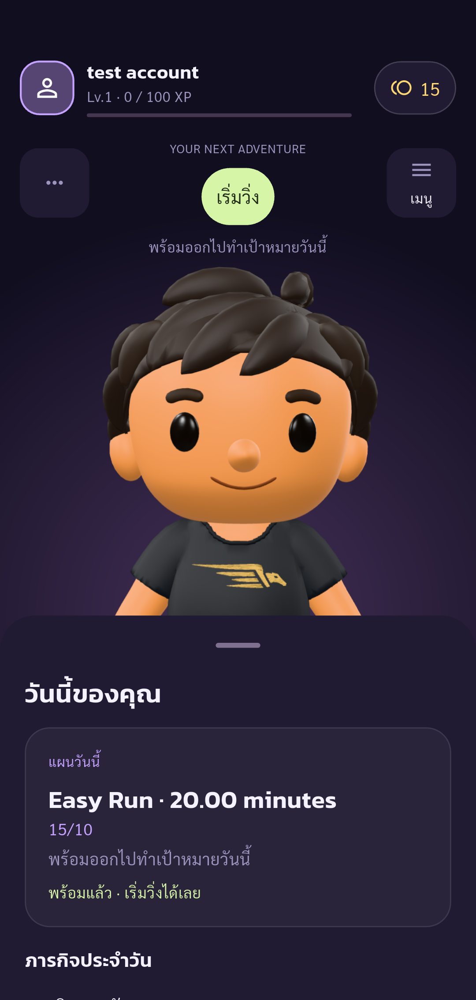
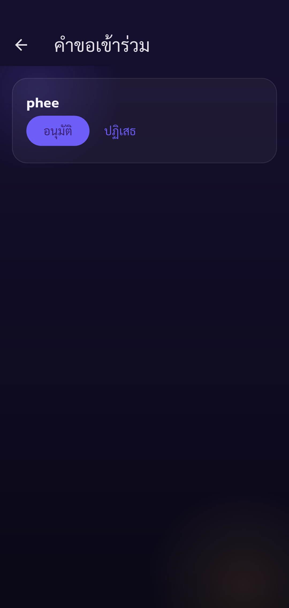
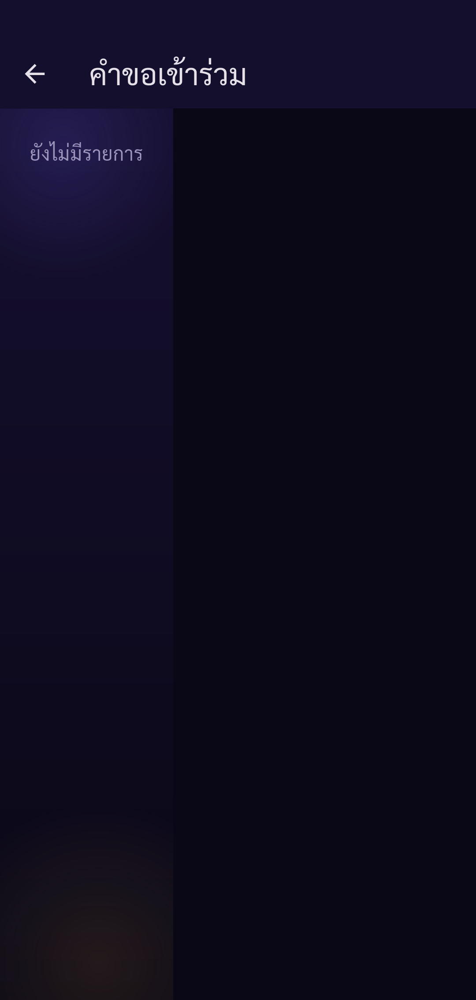
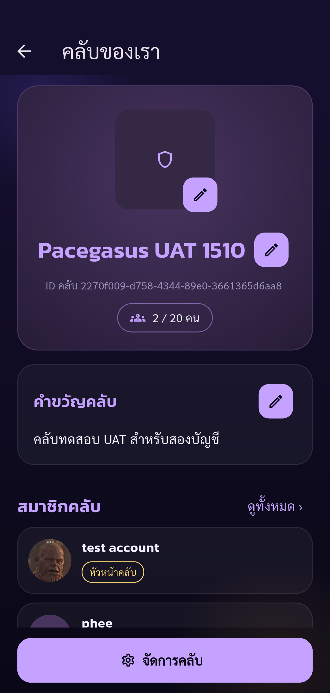

# Automated UAT — Pacegasus

Status: **passed**

Phase club-approve completed: only listed assertions passed. Other UAT cases remain Not Run.

Tests run through Flutter Integration Test against the configured real API.
Guided phase club-approve. Human operates real UI (including OTP); automatic API/state assertions and screenshots. Only checkpoint assertions are checked. Negative cases and other parts of the 88-case plan remain Not Run. No account deletion.

Screenshots support only the stated assertions. A completed phase does not mean all 88 UAT cases passed.

| Step | Result | Evidence |
| --- | --- | --- |
| Expected account authenticated, onboarding complete, real public UID verified | passed | [identity](screenshots/identity.png) |
| Leader sees secondary pending join request | passed | [club-incoming-request](screenshots/club-incoming-request.png) |
| Approval adds secondary exactly once as member, one leader remains, pending request cleared | passed | [club-approved-request-cleared](screenshots/club-approved-request-cleared.png) |
| Reloaded leader club screen shows approved secondary member; total two confirmed by API | passed | [club-two-members](screenshots/club-two-members.png) |

## Screenshots

### Expected account authenticated, onboarding complete, real public UID verified

### Leader sees secondary pending join request

### Approval adds secondary exactly once as member, one leader remains, pending request cleared

### Reloaded leader club screen shows approved secondary member; total two confirmed by API

