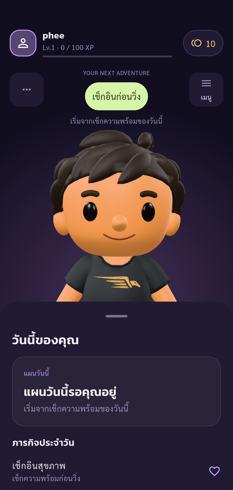
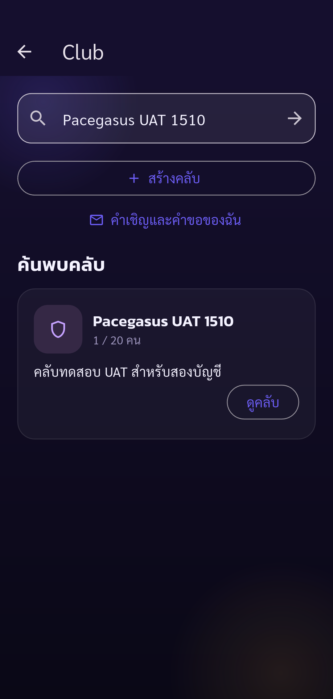
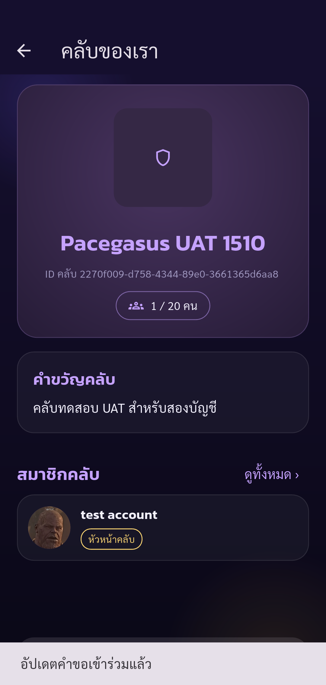

# Automated UAT — Pacegasus

Status: **passed**

Phase club-request completed: only listed assertions passed. Other UAT cases remain Not Run.

Tests run through Flutter Integration Test against the configured real API.
Guided phase club-request. Human operates real UI (including OTP); automatic API/state assertions and screenshots. Only checkpoint assertions are checked. Negative cases and other parts of the 88-case plan remain Not Run. No account deletion.

Screenshots support only the stated assertions. A completed phase does not mean all 88 UAT cases passed.

| Step | Result | Evidence |
| --- | --- | --- |
| Expected account authenticated, onboarding complete, real public UID verified | passed | [identity](screenshots/identity.png) |
| Secondary finds primary club by name in real search | passed | [club-search](screenshots/club-search.png) |
| Secondary request pending, repeat button disabled, not a member and count remains one | passed | [club-request-pending](screenshots/club-request-pending.png) |

## Screenshots

### Expected account authenticated, onboarding complete, real public UID verified

### Secondary finds primary club by name in real search

### Secondary request pending, repeat button disabled, not a member and count remains one

