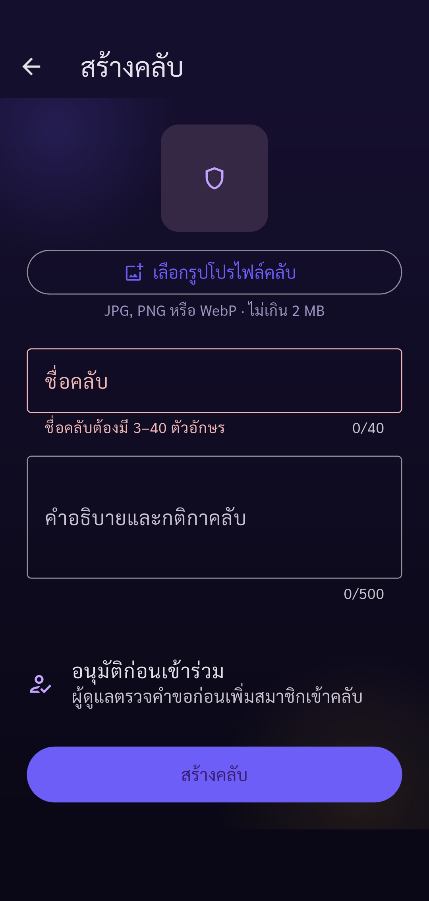
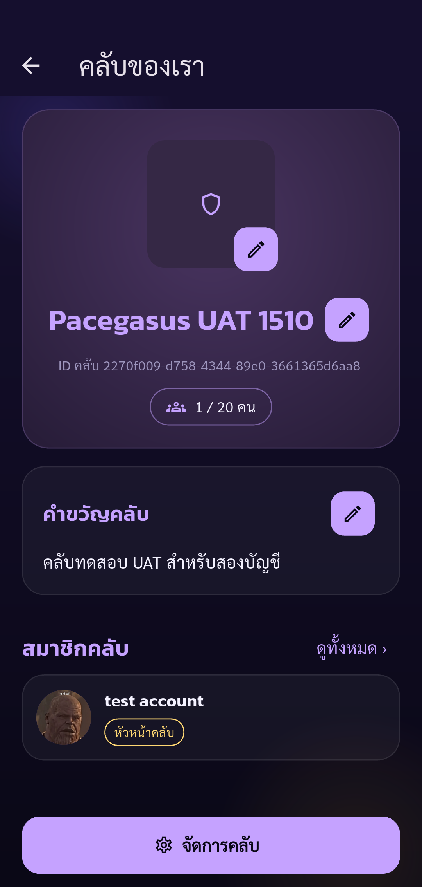

# Automated UAT — Pacegasus

Status: **passed**

Phase club-create completed: only listed assertions passed. Other UAT cases remain Not Run.

Tests run through Flutter Integration Test against the configured real API.
Guided phase club-create. Human operates real UI (including OTP); automatic API/state assertions and screenshots. Only checkpoint assertions are checked. Negative cases and other parts of the 88-case plan remain Not Run. No account deletion.

Screenshots support only the stated assertions. A completed phase does not mean all 88 UAT cases passed.

| Step | Result | Evidence |
| --- | --- | --- |
| Empty club name rejected; no club created | passed | [club-invalid-name](screenshots/club-invalid-name.png) |
| Main created expected club, leader role and exactly one member; UI and API agree | passed | [club-created](screenshots/club-created.png) |

## Screenshots

### Empty club name rejected; no club created

### Main created expected club, leader role and exactly one member; UI and API agree

