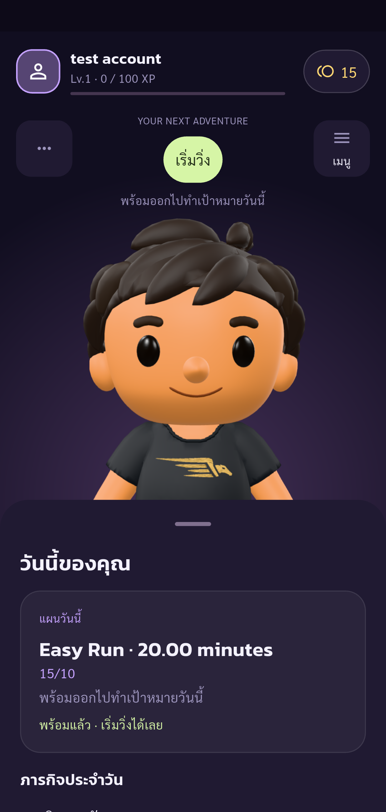
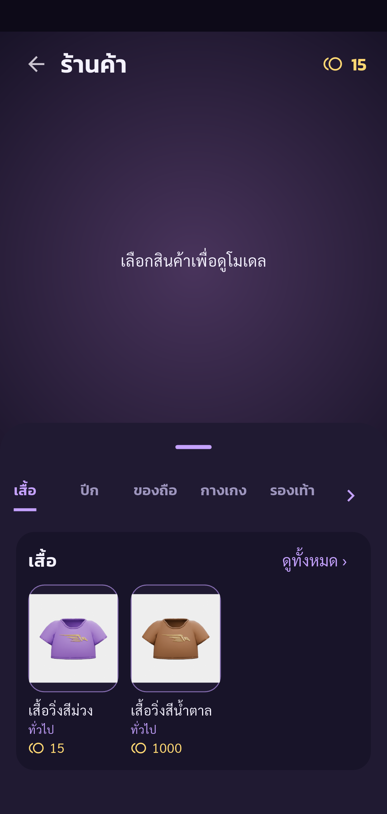
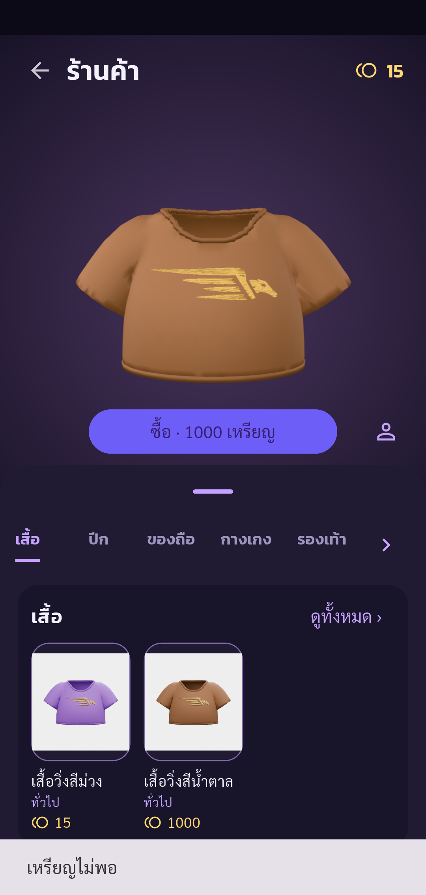
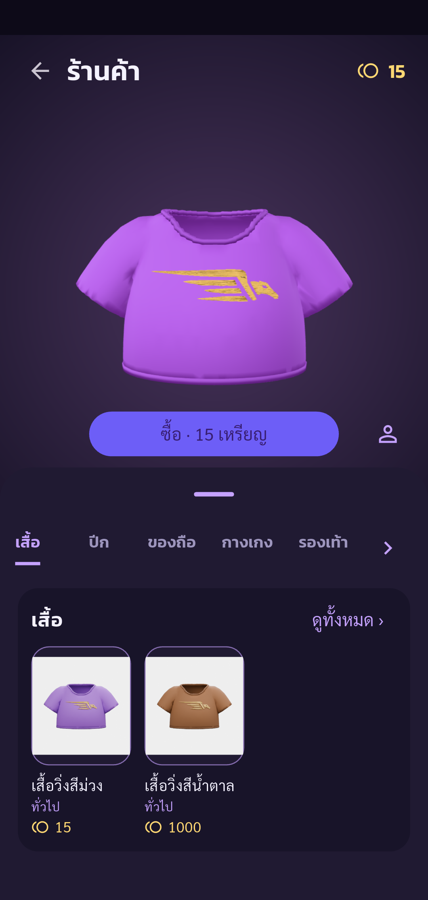
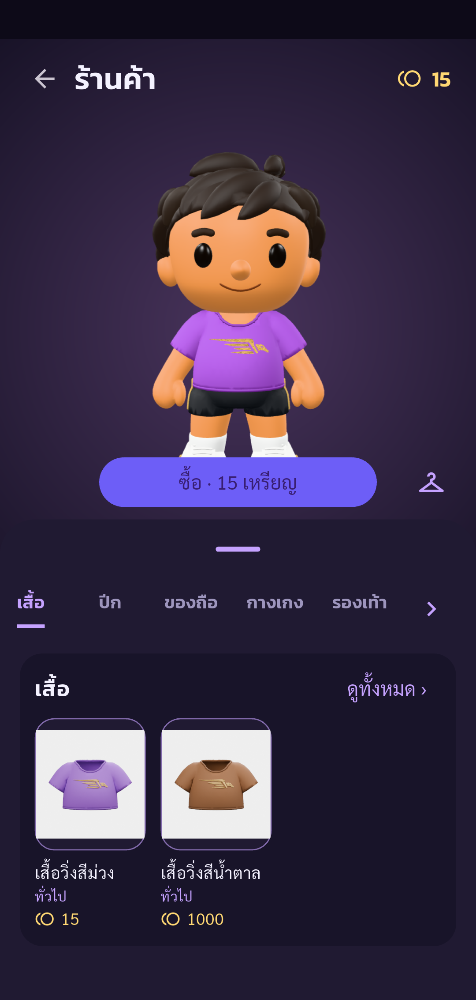
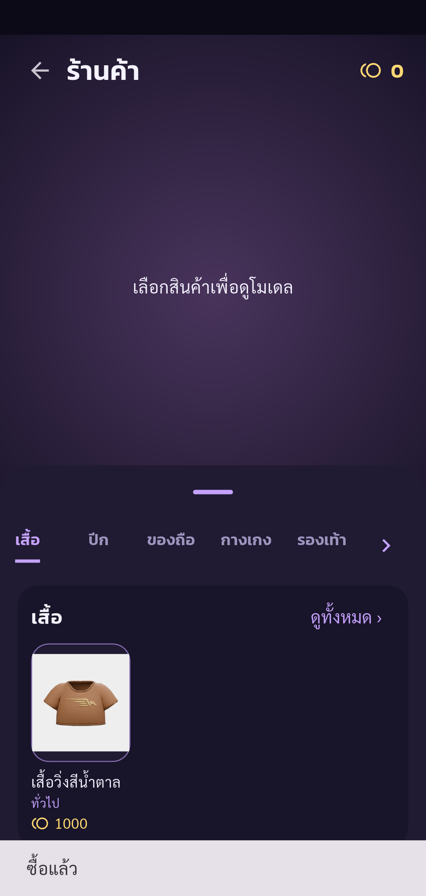
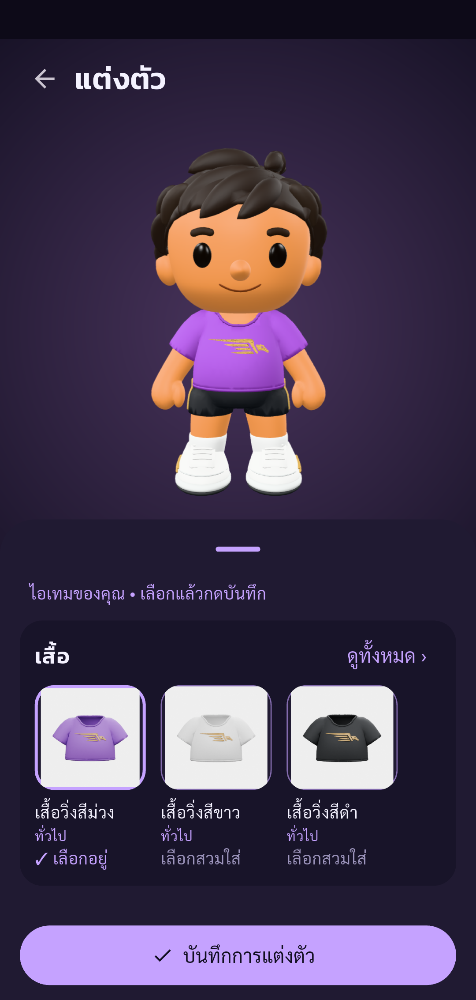
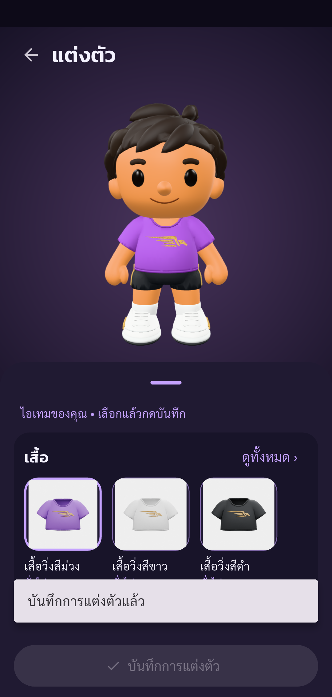
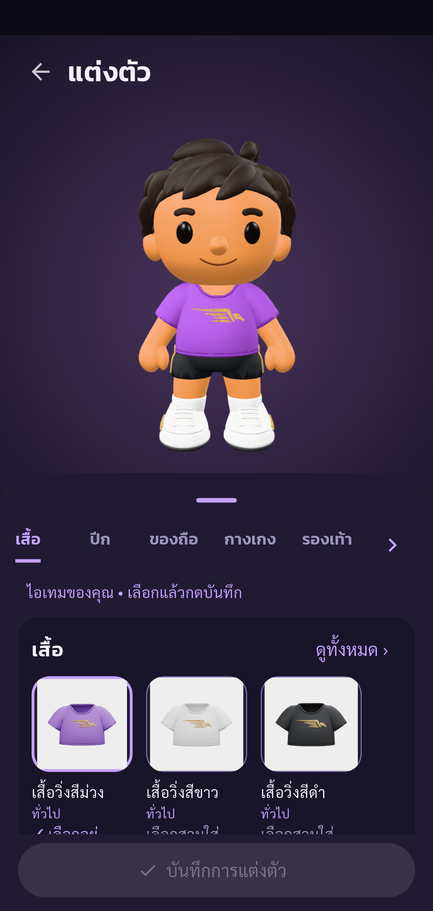

# Automated UAT — Pacegasus

Status: **passed**

Phase shop completed: only listed assertions passed. Other UAT cases remain Not Run.

Tests run through Flutter Integration Test against the configured real API.
Guided phase shop. Human operates real UI (including OTP); automatic API/state assertions and screenshots. Only checkpoint assertions are checked. Negative cases and other parts of the 88-case plan remain Not Run. No account deletion.

Screenshots support only the stated assertions. A completed phase does not mean all 88 UAT cases passed.

| Step | Result | Evidence |
| --- | --- | --- |
| Expected account authenticated, onboarding complete, real public UID verified | passed | [identity](screenshots/identity.png) |
| Shop loads real catalog and displays current coin balance | passed | [shop-catalog](screenshots/shop-catalog.png) |
| Insufficient coins rejected; balance, purchase history and ownership unchanged | passed | [shop-insufficient-coins](screenshots/shop-insufficient-coins.png) |
| Selected product shows actual price and product preview | passed | [shop-product](screenshots/shop-product.png) |
| Trying on unowned item changes preview only; saved equipment and ownership unchanged | passed | [shop-try-on](screenshots/shop-try-on.png) |
| Selected item ownership granted and exact price deducted (partial UAT-07-002) | passed | [shop-purchased](screenshots/shop-purchased.png) |
| Owned purchased item selected; equipment is not persisted before Save | passed | [avatar-draft](screenshots/avatar-draft.png) |
| Purchased item is saved in the matching avatar slot (partial UAT-07-008) | passed | [shop-equipped](screenshots/shop-equipped.png) |
| Home reloads saved purchased outfit after returning from wardrobe | passed | [avatar-home](screenshots/avatar-home.png) |
| Reopened wardrobe retains saved equipment; exactly one purchase and no further coin deduction | passed | [avatar-reopened](screenshots/avatar-reopened.png) |

## Screenshots

### Expected account authenticated, onboarding complete, real public UID verified

### Shop loads real catalog and displays current coin balance

### Insufficient coins rejected; balance, purchase history and ownership unchanged

### Selected product shows actual price and product preview

### Trying on unowned item changes preview only; saved equipment and ownership unchanged

### Selected item ownership granted and exact price deducted (partial UAT-07-002)

### Owned purchased item selected; equipment is not persisted before Save

### Purchased item is saved in the matching avatar slot (partial UAT-07-008)

### Home reloads saved purchased outfit after returning from wardrobe

### Reopened wardrobe retains saved equipment; exactly one purchase and no further coin deduction

