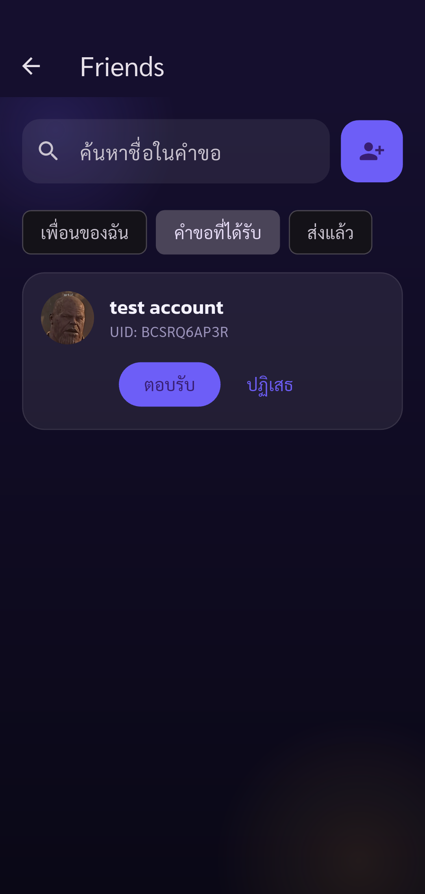
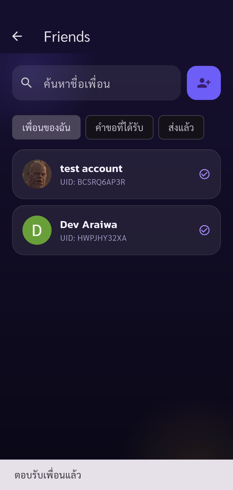

# Automated UAT — Pacegasus

Status: **passed**

Phase friends-accept completed: only listed assertions passed. Other UAT cases remain Not Run.

Tests run through Flutter Integration Test against the configured real API.
Guided phase friends-accept. Human operates real UI (including OTP); automatic API/state assertions and screenshots. Only checkpoint assertions are checked. Negative cases and other parts of the 88-case plan remain Not Run. No account deletion.

Screenshots support only the stated assertions. A completed phase does not mean all 88 UAT cases passed.

| Step | Result | Evidence |
| --- | --- | --- |
| Secondary sees the exact pending request sent by primary account | passed | [friend-incoming](screenshots/friend-incoming.png) |
| Recipient accepted once and sees primary in My Friends with same friendship ID | passed | [friend-accepted-secondary](screenshots/friend-accepted-secondary.png) |

## Screenshots

### Secondary sees the exact pending request sent by primary account

### Recipient accepted once and sees primary in My Friends with same friendship ID

