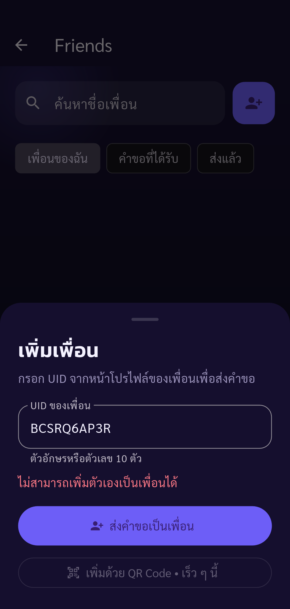
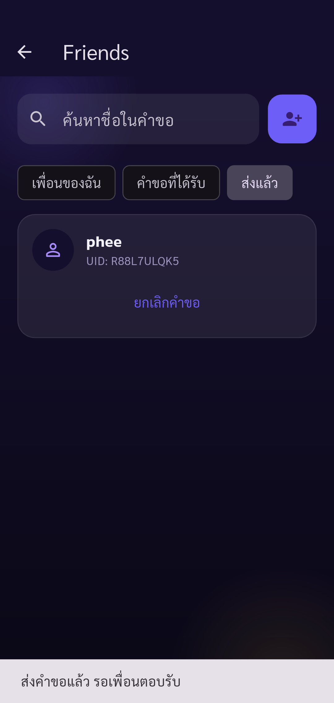
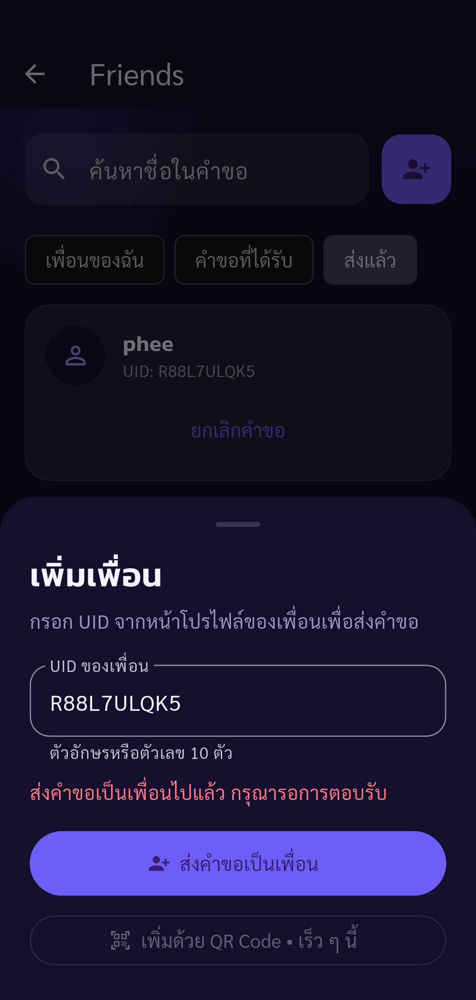
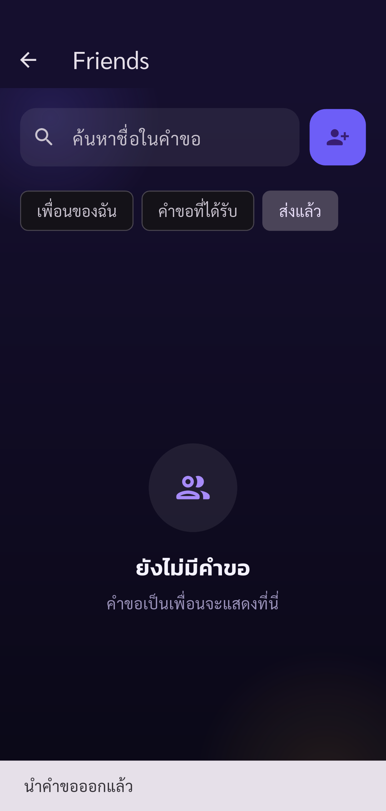

# Automated UAT — Pacegasus

Status: **passed**

Phase friends-send completed: only listed assertions passed. Other UAT cases remain Not Run.

Tests run through Flutter Integration Test against the configured real API.
Guided phase friends-send. Human operates real UI (including OTP); automatic API/state assertions and screenshots. Only checkpoint assertions are checked. Negative cases and other parts of the 88-case plan remain Not Run. No account deletion.

Screenshots support only the stated assertions. A completed phase does not mean all 88 UAT cases passed.

| Step | Result | Evidence |
| --- | --- | --- |
| Expected account authenticated, onboarding complete, real public UID verified | passed | [identity](screenshots/identity-send.png) |
| Invalid UID is rejected before any friendship request is created | passed | [friend-invalid-uid](screenshots/friend-invalid-uid.png) |
| App displays server rejection when main account tries to add its own UID | passed | [friend-self-rejected](screenshots/friend-self-rejected.png) |
| Lowercase secondary UID is accepted; pending request appears on Sent tab | passed | [friend-outgoing](screenshots/friend-outgoing.png) |
| Duplicate send rejected; exactly one outgoing request exists | passed | [friend-duplicate-rejected](screenshots/friend-duplicate-rejected.png) |
| Sender cancellation removes pending request from UI and real relationship | passed | [friend-request-cancelled](screenshots/friend-request-cancelled.png) |
| New single pending request to secondary remains ready for recipient acceptance | passed | [friend-resent](screenshots/friend-resent.png) |

## Screenshots

### Expected account authenticated, onboarding complete, real public UID verified

### Invalid UID is rejected before any friendship request is created

### App displays server rejection when main account tries to add its own UID

### Lowercase secondary UID is accepted; pending request appears on Sent tab

### Duplicate send rejected; exactly one outgoing request exists

### Sender cancellation removes pending request from UI and real relationship

### New single pending request to secondary remains ready for recipient acceptance

