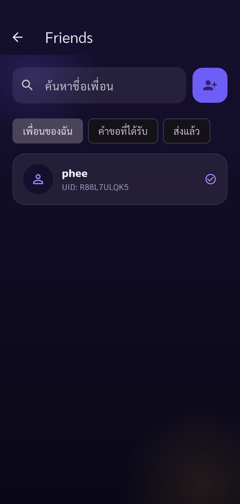
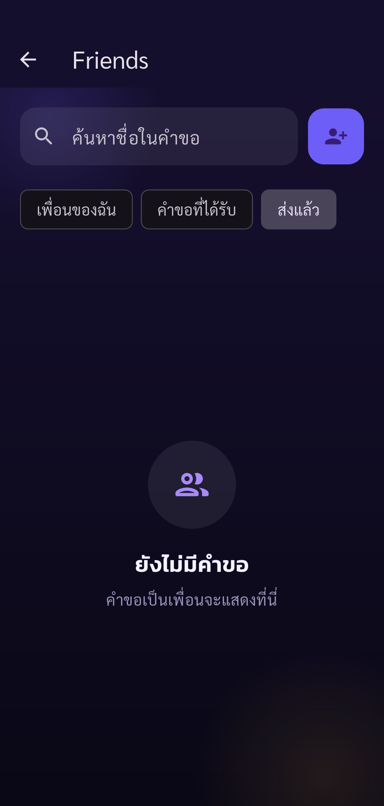

# Automated UAT — Pacegasus

Status: **passed**

Phase friends-verify completed: only listed assertions passed. Other UAT cases remain Not Run.

Tests run through Flutter Integration Test against the configured real API.
Guided phase friends-verify. Human operates real UI (including OTP); automatic API/state assertions and screenshots. Only checkpoint assertions are checked. Negative cases and other parts of the 88-case plan remain Not Run. No account deletion.

Screenshots support only the stated assertions. A completed phase does not mean all 88 UAT cases passed.

| Step | Result | Evidence |
| --- | --- | --- |
| Primary sees secondary in My Friends after recipient acceptance; exactly one same friendship | passed | [friend-accepted-primary](screenshots/friend-accepted-primary.png) |
| Accepted friendship no longer appears as outgoing pending request | passed | [friend-no-pending-after-accept](screenshots/friend-no-pending-after-accept.png) |

## Screenshots

### Primary sees secondary in My Friends after recipient acceptance; exactly one same friendship

### Accepted friendship no longer appears as outgoing pending request

