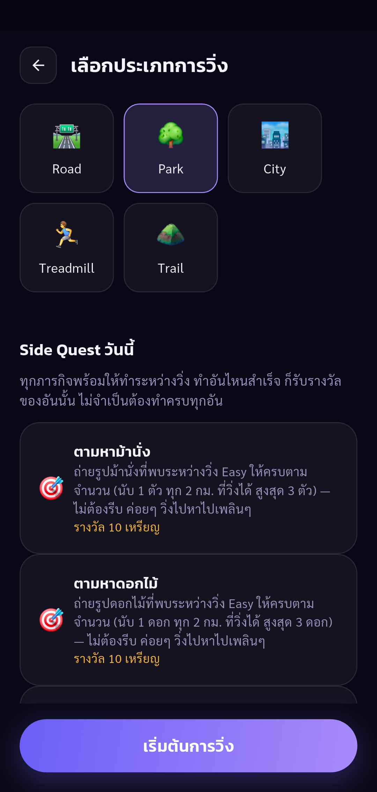
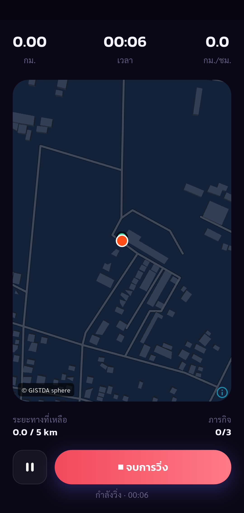
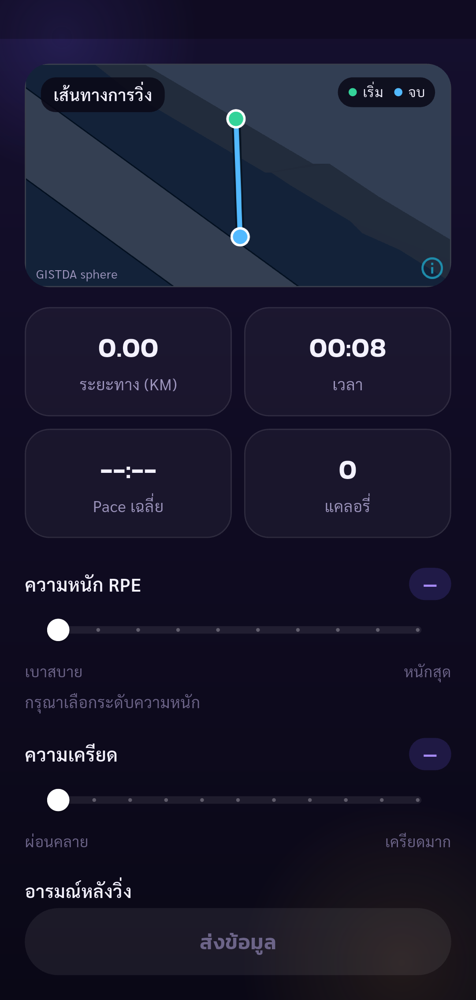
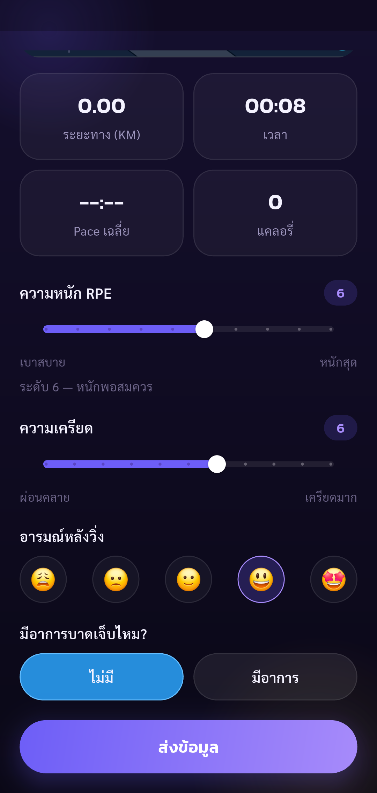
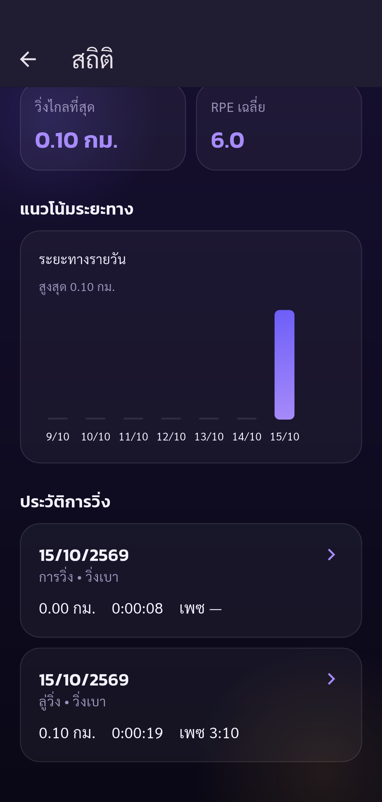
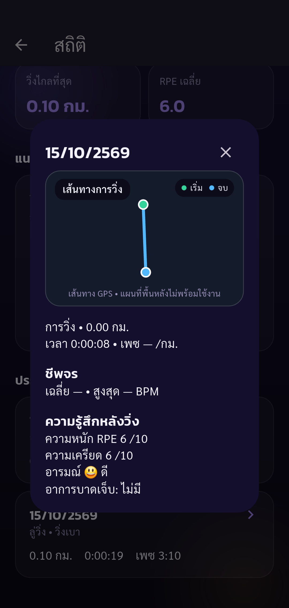

# Automated UAT — Pacegasus

Status: **passed**

Phase run-park completed: only listed assertions passed. Other UAT cases remain Not Run.

Tests run through Flutter Integration Test against the configured real API.
Real Park GPS acquisition, wait at least five seconds before finishing; no injected distance or location. Checks start/pause/resume/finish, feedback, reward consistency, stats/history and ranking. Stationary Park distance may be zero; this does not establish GPS distance accuracy. Other UAT cases remain Not Run.

Screenshots support only the stated assertions. A completed phase does not mean all 88 UAT cases passed.

| Step | Result | Evidence |
| --- | --- | --- |
| park selected; quest lookup finished before start; absent quest data reported separately | passed | [run-environment](screenshots/run-environment.png) |
| Park countdown has passed the app real-GPS-first-fix gate; waited at least five seconds with real timer before finish | passed | [park-gps-ready](screenshots/park-gps-ready.png) |
| Summary shows 0.00 km from real Park GPS; feedback incomplete so Submit disabled | passed | [run-summary](screenshots/run-summary.png) |
| RPE/stress selected, good mood and no pain; Submit enabled | passed | [run-feedback](screenshots/run-feedback.png) |
| Displayed coin reward matches actual server coin increase | passed | [run-reward](screenshots/run-reward.png) |
| Exactly one new completed session; stored feedback correct; Stats totals match API and new history row is visible | passed | [run-stats](screenshots/run-stats.png) |
| New park history detail opened after loading real session data | passed | [run-history-detail](screenshots/run-history-detail.png) |
| Ranking API returns Thai weekly period, descending Top 50 and own distance including new run; screen opened (partial UAT-03-020) | passed | [run-ranking](screenshots/run-ranking.png) |

## Screenshots

### park selected; quest lookup finished before start; absent quest data reported separately

### Park countdown has passed the app real-GPS-first-fix gate; waited at least five seconds with real timer before finish

### Summary shows 0.00 km from real Park GPS; feedback incomplete so Submit disabled

### RPE/stress selected, good mood and no pain; Submit enabled

### Displayed coin reward matches actual server coin increase

### Exactly one new completed session; stored feedback correct; Stats totals match API and new history row is visible

### New park history detail opened after loading real session data

### Ranking API returns Thai weekly period, descending Top 50 and own distance including new run; screen opened (partial UAT-03-020)

