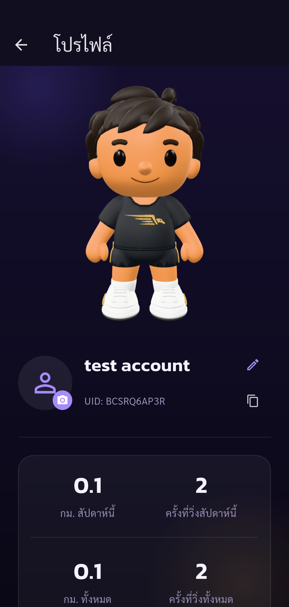
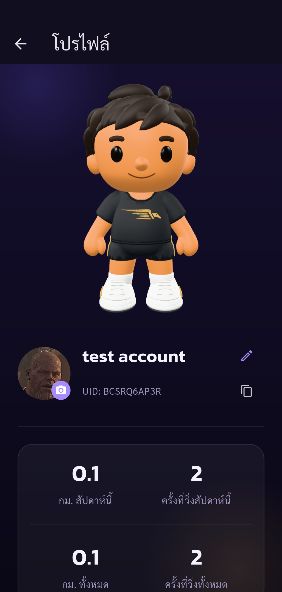

# Automated UAT — Pacegasus

Status: **passed**

Phase profile-image completed: only listed assertions passed. Other UAT cases remain Not Run.

Tests run through Flutter Integration Test against the configured real API.
Real profile photo upload using latest image selected from the phone native gallery as requested by user. Checks URL changed, image decodes in UI, account identity unchanged and photo persists after reopening. Selected photo remains applied. No logout, account deletion or gallery fixture injection.

Screenshots support only the stated assertions. A completed phase does not mean all 88 UAT cases passed.

| Step | Result | Evidence |
| --- | --- | --- |
| Expected account authenticated, onboarding complete, real public UID verified | passed | [identity](screenshots/identity-profile-image.png) |
| Profile loaded before changing photo with original name and UID | passed | [photo-before](screenshots/photo-before.png) |
| Photo URL changed, uploaded image decoded successfully in UI, name and UID unchanged | passed | [photo-uploaded](screenshots/photo-uploaded.png) |
| Reopened Profile loads the same new photo from server and image decodes successfully | passed | [photo-persisted](screenshots/photo-persisted.png) |

## Screenshots

### Expected account authenticated, onboarding complete, real public UID verified

### Profile loaded before changing photo with original name and UID

### Photo URL changed, uploaded image decoded successfully in UI, name and UID unchanged

### Reopened Profile loads the same new photo from server and image decodes successfully

