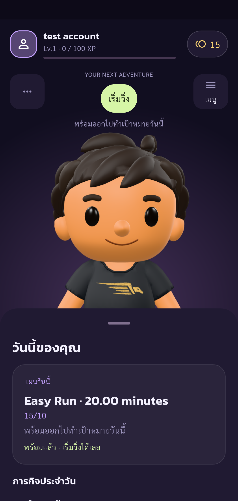

# Automated UAT — Pacegasus

Status: **passed**

Phase profile completed: only listed assertions passed. Other UAT cases remain Not Run.

Tests run through Flutter Integration Test against the configured real API.
Guided phase profile. Human operates real UI (including OTP); automatic API/state assertions and screenshots. Only checkpoint assertions are checked. Negative cases and other parts of the 88-case plan remain Not Run. No account deletion.

Screenshots support only the stated assertions. A completed phase does not mean all 88 UAT cases passed.

| Step | Result | Evidence |
| --- | --- | --- |
| Expected account authenticated, onboarding complete, real public UID verified | passed | [identity](screenshots/identity-profile.png) |
| Profile loads original account and Copy places exact public UID in clipboard | passed | [profile-uid](screenshots/profile-uid.png) |
| Whitespace-only name is rejected and stored name remains unchanged | passed | [profile-empty-rejected](screenshots/profile-empty-rejected.png) |
| Name field rejects or truncates 81-character input and accepts exactly 80 characters | passed | [profile-name-limit](screenshots/profile-name-limit.png) |
| Cancel discards edited text and preserves original name in UI and API | passed | [profile-cancel](screenshots/profile-cancel.png) |
| Changed profile name persists in real API and visible UI; UID unchanged (partial UAT-04-002) | passed | [profile-name](screenshots/profile-name.png) |
| Home displays new saved name; screenshot waits three seconds for model | passed | [profile-home-name](screenshots/profile-home-name.png) |
| Reopening Profile reloads the edited name from the real server | passed | [profile-name-restored-from-server](screenshots/profile-name-restored-from-server.png) |
| Original display name restored via UI and verified in server; no logout or deletion | passed | [profile-original-name-restored](screenshots/profile-original-name-restored.png) |

## Screenshots

### Expected account authenticated, onboarding complete, real public UID verified

### Profile loads original account and Copy places exact public UID in clipboard

### Whitespace-only name is rejected and stored name remains unchanged

### Name field rejects or truncates 81-character input and accepts exactly 80 characters

### Cancel discards edited text and preserves original name in UI and API

### Changed profile name persists in real API and visible UI; UID unchanged (partial UAT-04-002)

### Home displays new saved name; screenshot waits three seconds for model

### Reopening Profile reloads the edited name from the real server

### Original display name restored via UI and verified in server; no logout or deletion

