# Automated UAT — Pacegasus

Status: **passed**

Registration, four onboarding pages, Home, wellness and Profile passed. Other features are not covered by this suite.

Tests run through Flutter Integration Test against the configured real API.
Selected assertions only. Other UAT cases remain Not Run. No account deletion.

Screenshots support only the stated assertions. A completed phase does not mean all 88 UAT cases passed.

| Step | Result | Evidence |
| --- | --- | --- |
| Login opens without a saved session | passed | [01-login](screenshots/01-login.png) |
| Register accepts test account name and email | passed | [02-register](screenshots/02-register.png) |
| Terms requires consent before proceeding | passed | [03-terms-disabled](screenshots/03-terms-disabled.png) |
| Consent enables Continue | passed | [04-terms-consented](screenshots/04-terms-consented.png) |
| Register OTP requested for the specified email | passed | [05-otp-requested](screenshots/05-otp-requested.png) |
| OTP authenticates test account and opens onboarding | passed | [06-otp-verified](screenshots/06-otp-verified.png) |
| Synthetic birth date, gender, weight, height and training days validate | passed | [07-basic-valid](screenshots/07-basic-valid.png) |
| Synthetic no-condition and no-injury answers selected | passed | [08-health](screenshots/08-health.png) |
| Only increased-endurance health goal selected; no distance goal | passed | [09-goal](screenshots/09-goal.png) |
| Synthetic beginner running history selected | passed | [10-history](screenshots/10-history.png) |
| Onboarding completes and Home shows test account | passed | [11-home](screenshots/11-home.png) |
| Five required wellness scores enable Save | passed | [12-wellness-valid](screenshots/12-wellness-valid.png) |
| Real API accepts wellness and Home updates | passed | [13-wellness-saved](screenshots/13-wellness-saved.png) |
| Profile loads test account and public UID without a retry error | passed | [14-profile](screenshots/14-profile.png) |

## Screenshots

### Login opens without a saved session

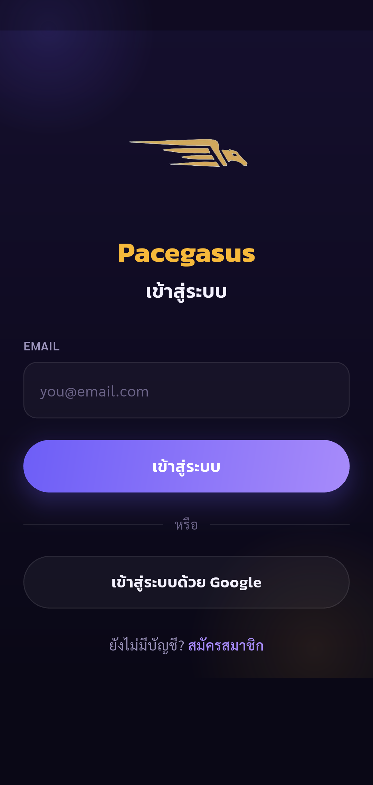

### Register accepts test account name and email

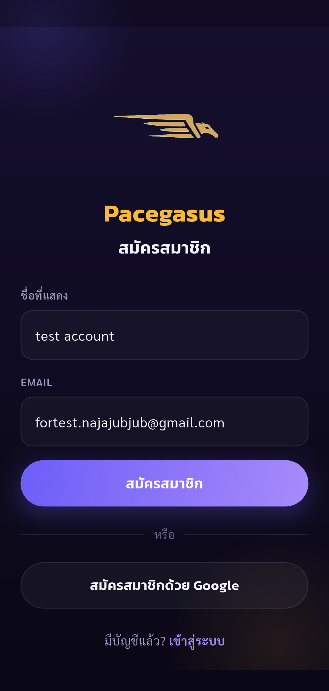

### Terms requires consent before proceeding

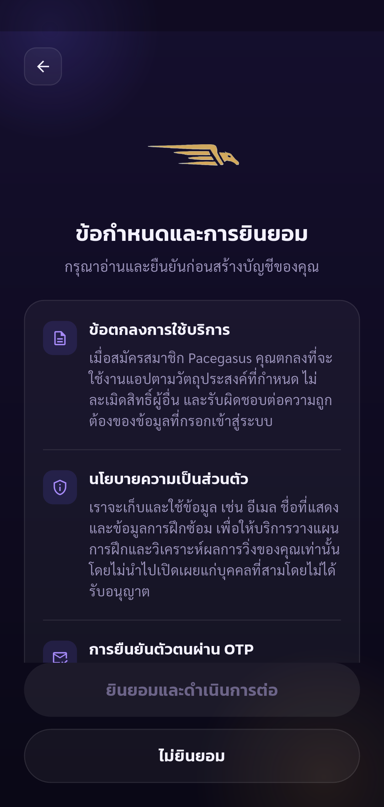

### Consent enables Continue

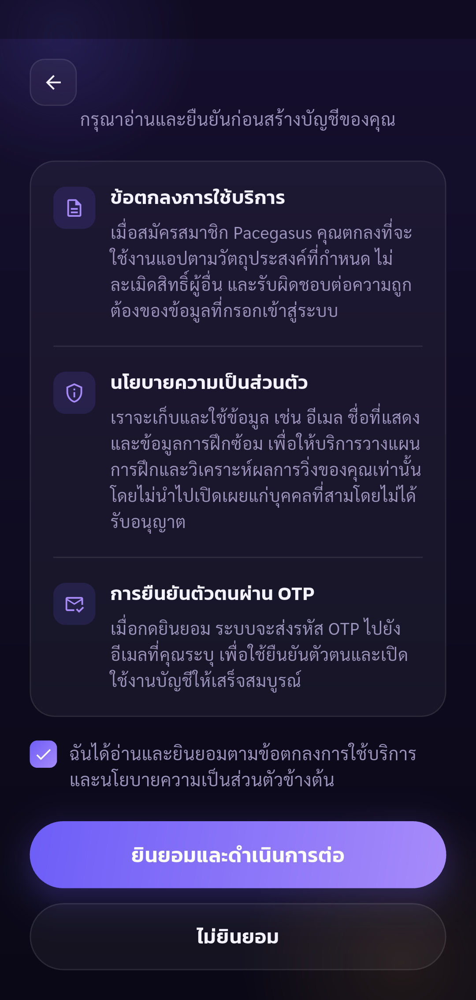

### Register OTP requested for the specified email

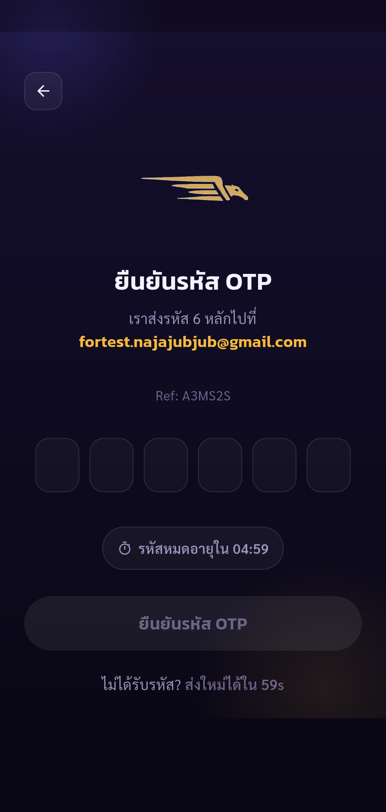

### OTP authenticates test account and opens onboarding

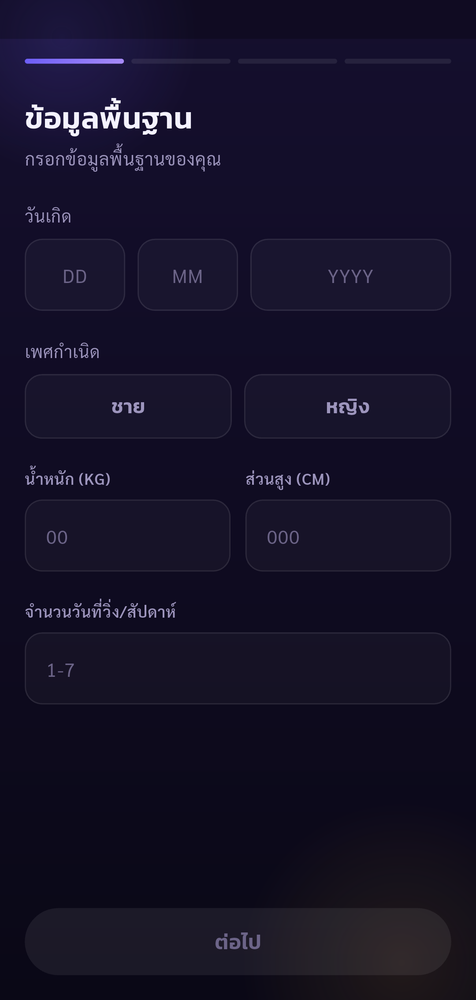

### Synthetic birth date, gender, weight, height and training days validate

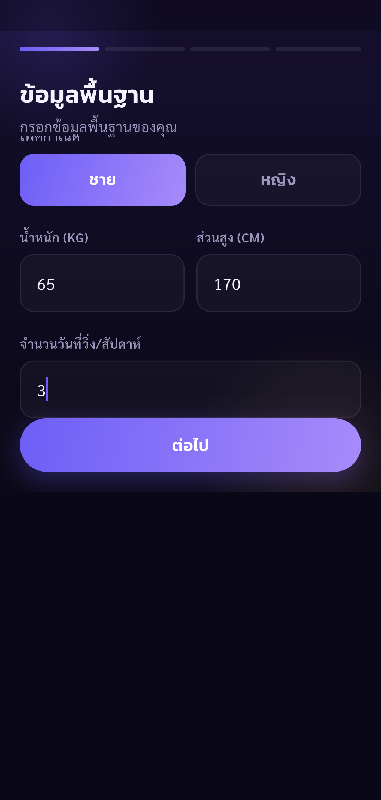

### Synthetic no-condition and no-injury answers selected

### Only increased-endurance health goal selected; no distance goal

### Synthetic beginner running history selected

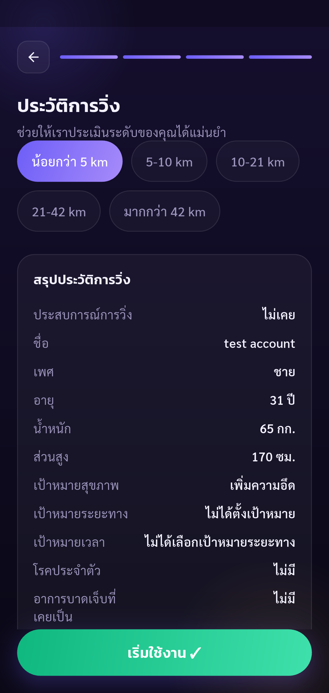

### Onboarding completes and Home shows test account

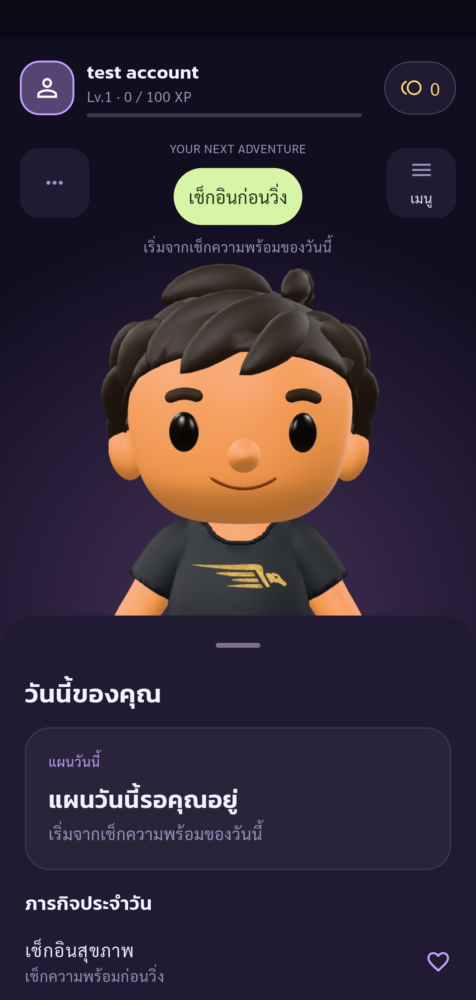

### Five required wellness scores enable Save

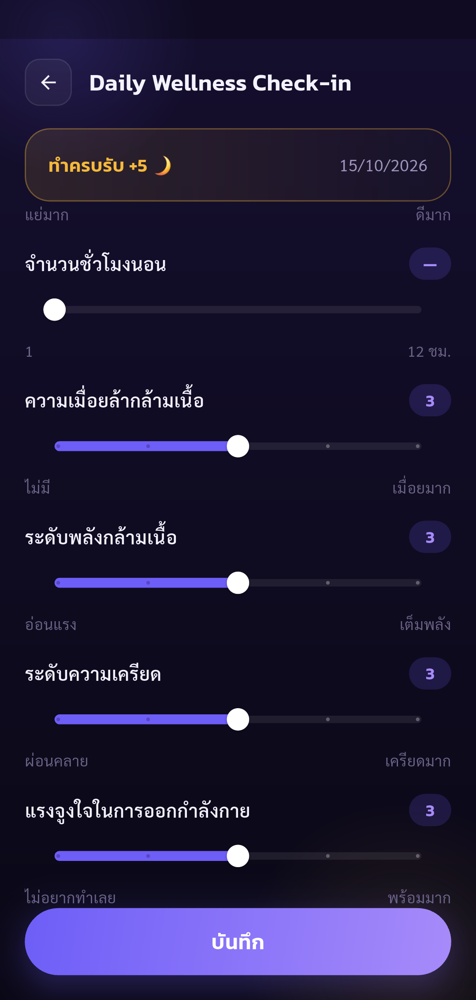

### Real API accepts wellness and Home updates

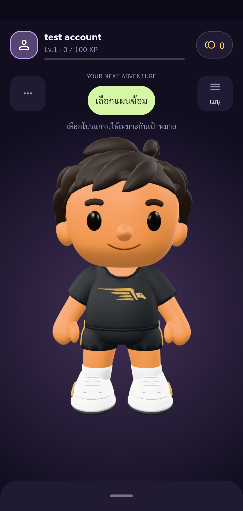

### Profile loads test account and public UID without a retry error

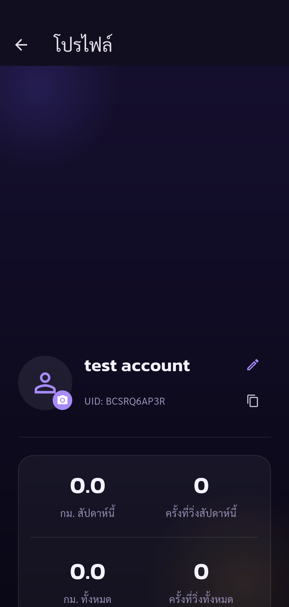
