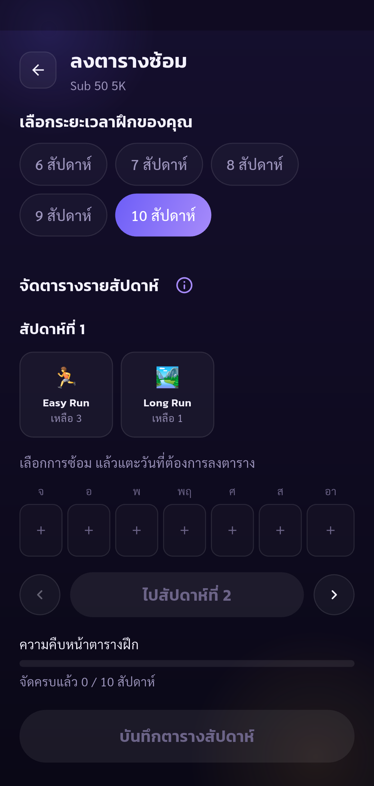
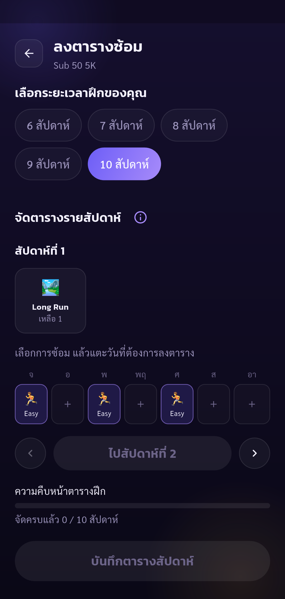
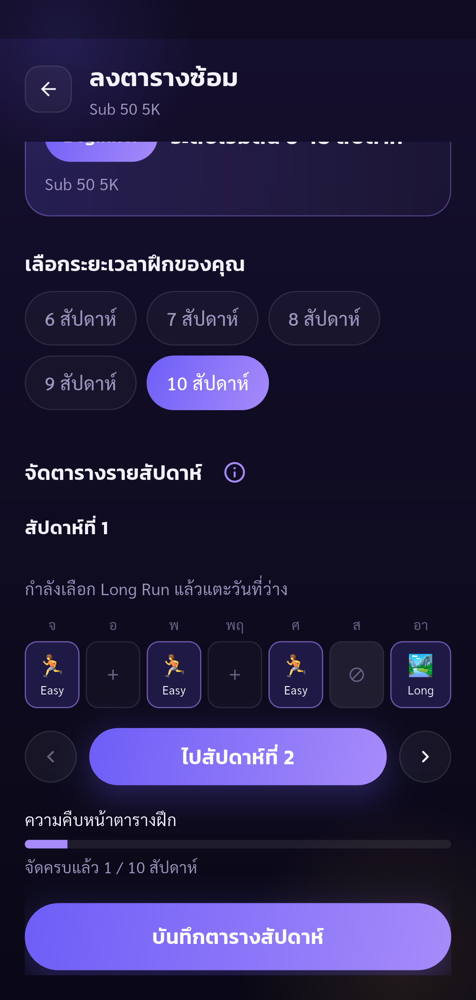
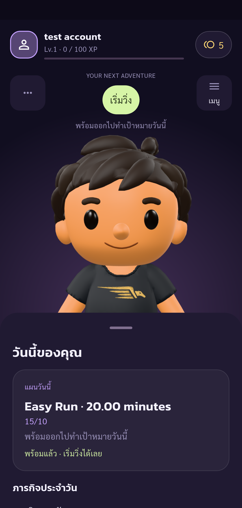
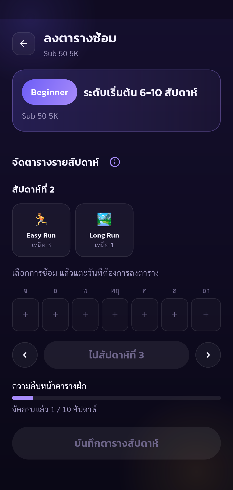

# Automated UAT — Pacegasus

Status: **passed**

Phase program completed: only listed assertions passed. Other UAT cases remain Not Run.

Tests run through Flutter Integration Test against the configured real API.
Guided phase program. Human operates real UI (including OTP); automatic API/state assertions and screenshots. Only checkpoint assertions are checked. Negative cases and other parts of the 88-case plan remain Not Run. No account deletion.

Screenshots support only the stated assertions. A completed phase does not mean all 88 UAT cases passed.

| Step | Result | Evidence |
| --- | --- | --- |
| New week cannot save before required workouts are placed | passed | [schedule-incomplete](screenshots/schedule-incomplete.png) |
| Three Easy Runs placed; Easy choice is removed at quota and an empty-day tap adds no fourth Easy | passed | [schedule-quota](screenshots/schedule-quota.png) |
| Week contains Easy on days 1/3/5 and Long Run on day 7; Save enabled | passed | [schedule-ready](screenshots/schedule-ready.png) |
| Resumed unsaved active program has four saved weekly quests: three Easy and one Long (partial UAT-02-008/010) | passed | [program-saved](screenshots/program-saved.png) |
| Reopened schedule matches saved day placement; API still has four quests | passed | [schedule-restored](screenshots/schedule-restored.png) |

## Screenshots

### New week cannot save before required workouts are placed

### Three Easy Runs placed; Easy choice is removed at quota and an empty-day tap adds no fourth Easy

### Week contains Easy on days 1/3/5 and Long Run on day 7; Save enabled

### Resumed unsaved active program has four saved weekly quests: three Easy and one Long (partial UAT-02-008/010)

### Reopened schedule matches saved day placement; API still has four quests

