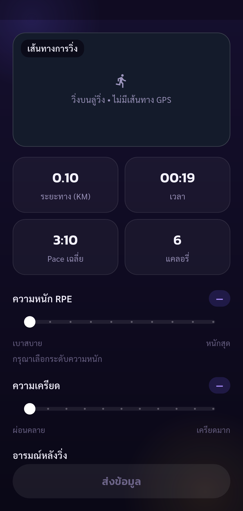

# Pacegasus — ผลทดสอบวงจรวิ่งในลู่

ผลตามขอบเขตที่แสดง: **ผ่าน — เริ่ม พัก วิ่งต่อ จบ และกรอก feedback**

รายงานฉบับนำเสนอแสดงเฉพาะวงจรวิ่งที่ตรวจผ่านในรอบลู่ ส่วนรางวัลหลังแก้ตรวจผ่านด้วย Park และยังไม่ได้รันทดสอบลู่ซ้ำ ผลรันต้นฉบับยังเก็บอยู่ใน [results.json](results.json) ไม่ได้เปลี่ยนผลรันเดิมเป็นผ่านทั้งชุด

Tests run through Flutter Integration Test against the configured real API.
ใช้ระยะกรอกทดสอบ 0.10 km และเวลาจริงจากแอป ตรวจเริ่ม พัก วิ่งต่อ จบ และ feedback ไม่ใช่การวิ่งจริงบนลู่หรือการตรวจความแม่นยำ GPS ผลประวัติและสถิติตรวจต่อในรายงานแยก

Screenshots support only the stated assertions. A completed phase does not mean all 88 UAT cases passed.

รางวัลหลังแก้ดูจาก [ผลวิ่ง Park](../gps_run/UAT-REPORT.md) โดยใช้ภาพหน้ารับรางวัลในรายงาน Park เพียงแห่งเดียว

| Step | Result | Evidence |
| --- | --- | --- |
| Treadmill selected; quest lookup finished before start; absent quest data reported separately; synthetic input disclosed | passed | [run-environment](screenshots/run-environment.png) |
| Real session is in progress; pause stops elapsed time for three seconds | passed | [run-paused](screenshots/run-paused.png) |
| Summary shows entered 0.10 km; feedback incomplete so Submit disabled | passed | [run-summary](screenshots/run-summary.png) |
| RPE/stress selected, good mood and no pain; Submit enabled | passed | [run-feedback](screenshots/run-feedback.png) |

## Screenshots

### Treadmill selected; quest lookup finished before start; absent quest data reported separately; synthetic input disclosed

### Real session is in progress; pause stops elapsed time for three seconds

### Summary shows entered 0.10 km; feedback incomplete so Submit disabled

### RPE/stress selected, good mood and no pain; Submit enabled

